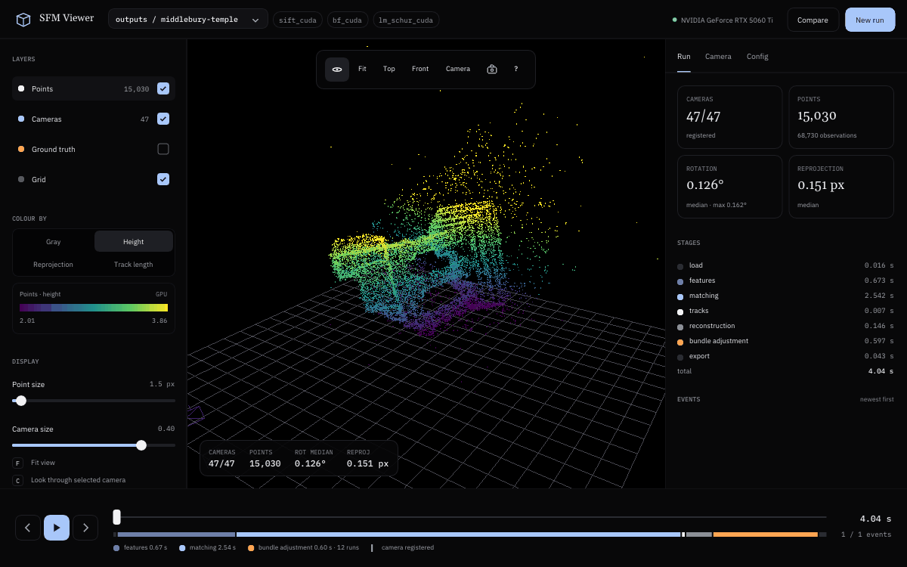
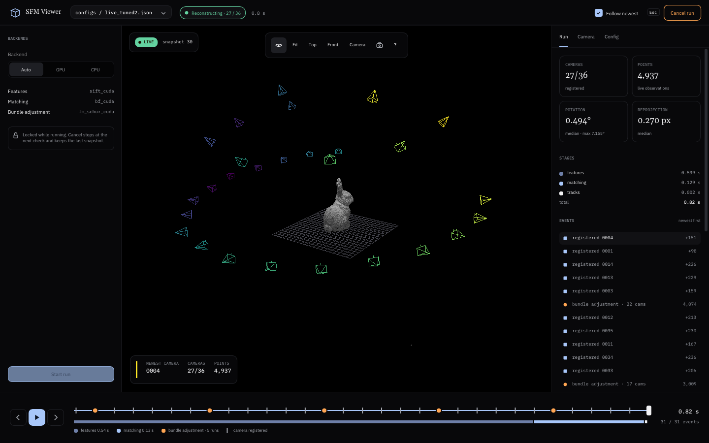

<div align="center">

<picture>
  <source media="(prefers-color-scheme: dark)" srcset="./.github/assets/banner-dark.svg">
  
</picture>

**Structure-from-Motion (SfM) and photogrammetry in C++17 and CUDA: 3D reconstruction from photos, with camera poses and a sparse point cloud, on an NVIDIA GPU or the CPU. An open-source, GPU-accelerated alternative to COLMAP for incremental SfM.**

[](https://github.com/Sovik-Ghosh/sfm-cuda/actions/workflows/ci.yml)
[](#requirements)
[](#requirements)
[](LICENSE)




</div>

## What it does

SFM is a Structure-from-Motion pipeline for 3D reconstruction from photos: it finds where each
photo was taken (camera poses) and builds a sparse 3D point cloud of the scene, the way
[COLMAP](https://colmap.github.io/) does, with every stage on the GPU (or, without one, on the CPU).
Use it for photogrammetry, multi-view geometry experiments, or as a C++/CUDA library:

- **Features:** SIFT or ORB, on the CPU or in CUDA (the CUDA versions give the same bits as the CPU ones).
- **Matching:** exact top-2 on the GPU (SIFT on the tensor cores), ratio test, 5-point E-RANSAC or F-RANSAC.
- **Reconstruction:** initial pair, PnP, multi-view triangulation, outlier filtering, local and global
  bundle adjustment (Levenberg–Marquardt with a Schur complement, in CUDA).
- **Rigid camera rigs:** several cameras fixed to each other are solved as one rig.
- **Viewer:** watch a reconstruction run live, replay it, inspect cameras, compare two runs.

On the included bunny dataset (36 views) the whole pipeline takes **0.9 s** on an RTX 5060 Ti and
reaches **0.17°** median rotation error, against COLMAP's 0.28°. On ETH3D scenes of ~1000 images
from a four-camera rig it registers every image at 0.09°–0.36° in 1–5 minutes.

## Requirements

| | Version | Notes |
|---|---|---|
| CMake | ≥ 3.24 | |
| C++ compiler | C++17 | tested with GCC 13 |
| CUDA Toolkit + NVIDIA GPU | 13.0 | **optional**: without them, build the CPU-only version (below) |
| GLFW 3 + OpenGL headers | | only for the viewer: `sudo apt install libglfw3-dev libgl-dev` |

Every stage has a CPU and a CUDA version, and both give the same results; the GPU is 4–70× faster
([benchmark](#cpu-vs-gpu)). GPU builds are tested on an RTX 5060 Ti (`sm_120`, the default); for
other GPUs add `-DCMAKE_CUDA_ARCHITECTURES=<arch>` (for example `86` for an RTX 30xx, `89` for an
RTX 40xx).

## Build

```bash
git clone https://github.com/Sovik-Ghosh/sfm-cuda.git
cd sfm-cuda
cmake --preset release                 # add -DCMAKE_CUDA_ARCHITECTURES=<arch> for other GPUs
cmake --build --preset release -j
ctest --preset release                 # optional: the tests (GPU tests need a visible GPU)
```

The programs are in `build/release/inference/apps/`.

**No NVIDIA GPU or no CUDA toolkit?** Build the CPU-only version; everything else below works the
same, with `build/cpu/` instead of `build/release/`:

```bash
cmake --preset cpu && cmake --build --preset cpu -j && ctest --preset cpu
```

A config that asks for CUDA methods (`sift_cuda`, …) runs on their CPU versions when there is no GPU
or no CUDA support (the run log says so); `sfm_run <config> --backend cpu|gpu` chooses explicitly.

## Run on the bunny

```bash
# Reconstruct: SIFT, matching and bundle adjustment on the GPU
./build/release/inference/apps/sfm_run configs/bunny_sift_tuned2.json

# Watch it run live in the viewer
./build/release/inference/apps/sfm_viewer configs/bunny_sift_tuned2.json --run

# Open the finished run
./build/release/inference/apps/sfm_viewer outputs/bunny-sift-tuned2
```

A run writes `outputs/<run name>/`:

| File | Contents |
|---|---|
| `model.ply` | the point cloud (MeshLab, CloudCompare, Blender) |
| `colmap/` | cameras, images and points in COLMAP's text format |
| `metrics.json` | registered images, points, reprojection error, errors against the ground truth |
| `timings.json`, `run.log` | time per stage, the event log |
| `stages/` | each stage's output; `sfm_run <config> --from reconstruction` re-runs only the later stages |

The other bunny configs: `bunny_sift.json` and `bunny_sift_tuned.json` (fewer / more SIFT keypoints),
`bunny_gpu.json` (ORB on the GPU), `bunny.json` (ORB, all on the CPU, no GPU needed).

| Config | Registered | Points | Rotation error (median / max) | Time |
|---|---|---|---|---|
| `bunny_sift_tuned2.json` | 36 / 36 | 5960 | **0.17° / 0.53°** | 0.9 s |
| `bunny_sift.json` | 36 / 36 | 3736 | 0.26° / 0.58° | 0.8 s |
| `bunny_gpu.json` (ORB) | 35 / 36 | 6805 | 0.55° / 4.5° | 0.8 s |
| COLMAP 4.2 (same masks and intrinsics) | 36 / 36 | | 0.28° / 0.64° | |

## CPU vs GPU

`bench_stages <config>` runs a config on the CPU methods and on the CUDA methods and prints the time
per stage. Ryzen 7 9700X (16 threads) against an RTX 5060 Ti; both give the same result on each:

| Config | Images | CPU | GPU | Speed-up | Result |
|---|---|---|---|---|---|
| `bunny.json` (ORB) | 36 | 2.3 s | 0.62 s | 3.8× | 35 / 36, 0.55° |
| `bunny_sift_tuned2.json` (SIFT) | 36 | 26 s | 0.79 s | 33× | 36 / 36, 0.17° |
| Middlebury templeRing | 47 | 48 s | 3.4 s | 14× | 47 / 47, 0.13° |
| ETH3D courtyard (1550×1032) | 38 | 292 s | 4.1 s | 71× | 38 / 38, 0.034° |
| ETH3D delivery_area, one camera | 237 | 105 s | 6.5 s | 16× | 237 / 237, 0.27° |

On the CPU most of the time is SIFT (about 0.6–1.5 s per image) and matching; ORB configs are the
fast choice there. The ETH3D and Middlebury data are not included.

```bash
./build/release/inference/apps/bench_stages configs/bunny_sift_tuned2.json
```

## Use your own images

1. **Images:** name them `0000.ppm`, `0001.ppm`, … in one folder, all the same size. To convert
   JPEGs: `mogrify -format ppm *.jpg` (ImageMagick), then rename in order.
2. **Intrinsics:** for each image `calib/0000.txt`, … with the 3×4 matrix `P = K [I | 0]`:
   ```text
   CONTOUR
   fx 0  cx 0
   0  fy cy 0
   0  0  1  0
   ```
   (`fx`, `fy` = focal length in pixels; `cx`, `cy` = image centre). If you know the true camera
   poses, use the full `P = K [R | t]`: `metrics.json` then reports the errors against them.
3. **Config:** copy `configs/bunny_sift_tuned2.json` and change the `dataset` block:
   ```json
   "dataset": { "root": "data/mine", "images_dir": "images", "calib_dir": "calib",
                "masks_dir": "", "first": 0, "last": 99, "use_masks": false }
   ```
   and `run.name` (the output folder). For a video or a walk, use sequential pairs instead of all
   pairs: `"pairs": { "mode": "sequential", "window": 10, "keyframe_stride": 10 }`. For many images
   raise `memory.max_images` and `memory.arena_mb`.
4. **Run:** `sfm_run configs/mine.json`, then `sfm_viewer outputs/<run name>`.

Masks (optional) are `masks/0000.pgm`, …: black = object, everything else ignored.

## Viewer

<div align="center">


</div>

| Do | How |
|---|---|
| Open a run / run a config live | `sfm_viewer outputs/<run>` / `sfm_viewer <config> --run [--backend gpu\|cpu]` |
| Compare two runs | `sfm_viewer outputs/a --compare outputs/b [--layout side\|overlay\|wipe]` |
| Orbit, pan, zoom | left drag, right drag, wheel; `F` fit, `C` look through the selected camera |
| Inspect | click a camera (image, errors); hover a point (its track) |
| Replay | drag the timeline, `Space` or ▶ plays (a run opened from disk replays its registration order) |
| Screenshot, all shortcuts | `S`, `?` |

## Use the library

```cmake
set(SFM_BUILD_TESTS OFF CACHE BOOL "" FORCE)
add_subdirectory(path/to/SFM sfm)
target_link_libraries(my_app PRIVATE sfm::pipeline)
```

```cpp
#include "sfm/config/config.hpp"
#include "sfm/core/logger.hpp"
#include "sfm/pipeline/pipeline.hpp"

int main() {
  const auto cfg = sfm::config::load_config("configs/bunny_sift_tuned2.json");
  sfm::core::Logger log(cfg.run.log_level);
  const auto result = sfm::pipeline::run_pipeline(cfg, {}, log);  // writes outputs/<run name>/
  return result.metrics ? 0 : 1;
}
```

The headers are in [`inference/include/sfm/`](inference/include/sfm/).

## Docker

```bash
docker build -f docker/Dockerfile -t sfm .
docker run --rm --gpus all -v "$PWD:/work" -w /work sfm sfm_run configs/bunny_sift_tuned2.json
```

Needs the [NVIDIA Container Toolkit](https://docs.nvidia.com/datacenter/cloud-native/container-toolkit/).
The image has `sfm_run`, `sfm_inspect` and `sfm_version` (no viewer).

## Data

`data/bunny/`: the "bunny" dataset (36 views, silhouettes, calibration) by Kalin Kolev and Daniel
Cremers, University of Bonn. The ETH3D ([eth3d.net](https://www.eth3d.net/datasets), CC BY-NC-SA
4.0) and Middlebury ([vision.middlebury.edu/mview](https://vision.middlebury.edu/mview/data/))
results above were measured on those datasets, which are not included.

## Questions and feedback

Questions, ideas, or results on your own data: [Discussions](https://github.com/Sovik-Ghosh/sfm-cuda/discussions).
Bugs: [Issues](https://github.com/Sovik-Ghosh/sfm-cuda/issues), with the command you ran and its `run.log`.

## License and citation

[Apache 2.0](LICENSE). Third-party code in [`third_party/`](third_party/) keeps its own licence.
To cite this software, see [`CITATION.cff`](CITATION.cff).
