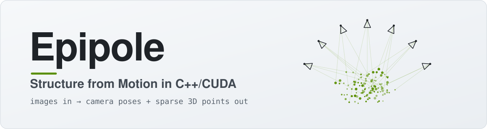
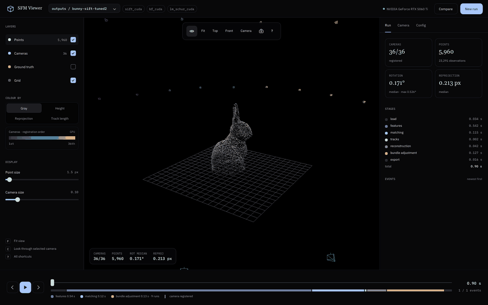
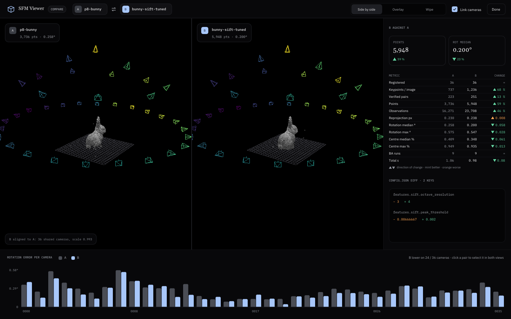

<div align="center">

<picture>
  <source media="(prefers-color-scheme: dark)" srcset="./.github/assets/banner-dark.svg">
  
</picture>

**Epipole is open-source Structure-from-Motion (SfM) and photogrammetry in C++17 and CUDA: 3D reconstruction from photos, with camera poses and a sparse point cloud, on an NVIDIA GPU or the CPU. A GPU-accelerated alternative to COLMAP for incremental SfM.**

[](https://github.com/Sovik-Ghosh/sfm-cuda/actions/workflows/ci.yml)
[](#requirements)
[](#requirements)
[](LICENSE)




</div>

## What it does

Epipole is a Structure-from-Motion pipeline for 3D reconstruction from photos: it finds where each
photo was taken (camera poses) and builds a sparse 3D point cloud of the scene, the way
[COLMAP](https://colmap.github.io/) does, with every stage on the GPU (or, without one, on the CPU).
Use it for photogrammetry, multi-view geometry experiments, or as a C++/CUDA library:

- **Features:** SIFT or ORB, on the CPU or in CUDA (the CUDA versions give the same bits as the CPU ones).
- **Matching:** exact top-2 on the GPU (SIFT on the tensor cores), ratio test, 5-point E-RANSAC or F-RANSAC.
- **Reconstruction:** initial pair, PnP, multi-view triangulation, outlier filtering, local and global
  bundle adjustment (Levenberg–Marquardt with a Schur complement, in CUDA).
- **Rigid camera rigs:** several cameras fixed to each other are solved as one rig.
- **Viewer:** watch a reconstruction run live, replay it, inspect cameras, compare two runs.
- **Python:** `epipole.reconstruct("photos/")` returns poses and a coloured point cloud as NumPy
  arrays.
- **Cameras:** focal length from EXIF (and refined), known or estimated radial lens distortion.

On the included bunny dataset (36 views) the whole pipeline takes **0.9 s** on an RTX 5060 Ti and
reaches **0.17°** median rotation error; COLMAP 4.2.1 built with CUDA takes 2.5 s and reaches 0.28°
on the same input. On ETH3D scenes of ~1000 images
from a four-camera rig it registers every image at 0.09°–0.36° in 1–5 minutes.

## Requirements

| | Version | Notes |
|---|---|---|
| CMake | ≥ 3.24 | |
| C++ compiler | C++17 | tested with GCC 13 |
| CUDA Toolkit + NVIDIA GPU | 13.0, RTX 20xx or newer (`sm_75`+) | **optional**: without them, build the CPU-only version (below) |
| GLFW 3 + OpenGL headers | | only for the viewer: `sudo apt install libglfw3-dev libgl-dev` |

No OpenCV, no Ceres: the only dependencies are CUDA (optional) and the header-only libraries in
[`third_party/`](third_party/) (Eigen, nlohmann/json, stb, Dear ImGui), plus GLFW for the viewer.

Every stage has a CPU and a CUDA version, and both give the same results; the GPU is 2–60× faster
([benchmark](#cpu-vs-gpu)). The default build runs on RTX 20xx to 50xx (`sm_75`, `86`, `89`,
`120`); tested on an RTX 5060 Ti. A GPU outside that list runs on the CPU, and the run log says so
and names the flag to add (`-DCMAKE_CUDA_ARCHITECTURES=<arch>`, e.g. `90` for an H100).

## Build

```bash
git clone --depth 1 https://github.com/Sovik-Ghosh/sfm-cuda.git   # --depth 1: 50 MB instead of 440 MB
cd sfm-cuda
cmake --preset release
cmake --build --preset release -j
ctest --preset release                 # optional: the tests (GPU tests need a visible GPU)
```

The programs are in `build/release/inference/apps/`. Without the GLFW packages the build skips the
viewer (the configure output says so).

**Prebuilt binaries:** the [latest release](https://github.com/Sovik-Ghosh/sfm-cuda/releases/latest)
has Linux x86-64 archives, CPU-only and CUDA (the CUDA one needs the CUDA 13 runtime libraries).
Run them from a clone, which holds the configs and the bunny.

**No NVIDIA GPU or no CUDA toolkit?** Build the CPU-only version; everything else below works the
same, with `build/cpu/` instead of `build/release/`:

```bash
cmake --preset cpu && cmake --build --preset cpu -j && ctest --preset cpu
```

A config that asks for CUDA methods (`sift_cuda`, …) runs on their CPU versions when there is no GPU
or no CUDA support (the run log says so); `sfm_run <config> --backend cpu|gpu` chooses explicitly.

## Run on the bunny

```bash
# Reconstruct: SIFT, matching and bundle adjustment on the GPU
./build/release/inference/apps/sfm_run configs/bunny_sift_tuned2.json

# Watch it run live in the viewer
./build/release/inference/apps/sfm_viewer configs/bunny_sift_tuned2.json --run

# Open the finished run
./build/release/inference/apps/sfm_viewer outputs/bunny-sift-tuned2
```

A run writes `outputs/<run name>/`:

| File | Contents |
|---|---|
| `model.ply` | the point cloud (MeshLab, CloudCompare, Blender) |
| `colmap/` | cameras, images and points (with their colours) in COLMAP's text and binary formats |
| `scene/` | with `"output": {"colmap_scene": true}`: `images/` + `sparse/0/`, the folder 3D Gaussian Splatting, nerfstudio and gsplat open as it is |
| `metrics.json` | registered images, points, reprojection error, errors against the ground truth |
| `timings.json`, `run.log` | time per stage, the event log |
| `stages/` | each stage's output; `sfm_run <config> --from reconstruction` re-runs only the later stages |

The other bunny configs: `bunny_sift.json` and `bunny_sift_tuned.json` (fewer / more SIFT keypoints),
`bunny_gpu.json` (ORB on the GPU), `bunny.json` (ORB, all on the CPU, no GPU needed).

| Config | Registered | Points | Rotation error (median / max) | Time |
|---|---|---|---|---|
| `bunny_sift_tuned2.json` | 36 / 36 | 5960 | **0.17° / 0.53°** | 0.9 s |
| `bunny_sift.json` | 36 / 36 | 3736 | 0.26° / 0.58° | 0.8 s |
| `bunny_gpu.json` (ORB) | 35 / 36 | 6805 | 0.55° / 4.5° | 0.8 s |
| COLMAP 4.2.1, CUDA build (same masks and intrinsics) | 36 / 36 | 2346 | 0.28° / 0.59° | 2.5 s |

## CPU vs GPU

`bench_stages <config>` runs a config on the CPU methods and on the CUDA methods and prints the time
per stage (best of 3 after a warm-up run, so slightly below a single `sfm_run`). Ryzen 7 9700X (16
threads) against an RTX 5060 Ti; both give the same result on each. The ETH3D rows use the default
configs; the [project page](https://sovik-ghosh.github.io/sfm-cuda/) lists the tuned configs'
accuracy (courtyard 0.030°, delivery_area 0.20°):

| Config | Images | CPU | GPU | Speed-up | Result |
|---|---|---|---|---|---|
| `bunny.json` (ORB) | 36 | 1.3 s | 0.62 s | 2.1× | 35 / 36, 0.55° |
| `bunny_sift_tuned2.json` (SIFT) | 36 | 8.3 s | 0.79 s | 10× | 36 / 36, 0.17° |
| Middlebury templeRing | 47 | 34 s | 3.4 s | 10× | 47 / 47, 0.13° |
| ETH3D courtyard (1550×1032) | 38 | 245 s | 4.1 s | 60× | 38 / 38, 0.034° |
| ETH3D delivery_area, one camera | 237 | 41 s | 6.5 s | 6× | 237 / 237, 0.27° |

On the CPU most of the time is exact SIFT matching (all pairs); ORB configs are the fast choice
there. The ETH3D and Middlebury data are not included.

**Against COLMAP** (4.2.1 built with CUDA, bunny, same masks and fixed intrinsics, best of 3):

| | Features | Matching | Reconstruction | Total | Rotation error (median) |
|---|---|---|---|---|---|
| Epipole, GPU | 0.45 s | 0.11 s | 0.17 s | **0.77 s** | **0.17°** |
| COLMAP, GPU (SIFT, matching and BA) | 0.94 s | 0.31 s | 1.25 s | 2.5 s | 0.28° |
| COLMAP, CPU | 1.6 s | 1.2 s | 1.2 s | 4.0 s | 0.29° |
| Epipole, CPU | 3.3 s | 4.5 s | 0.48 s | 8.3 s | 0.17° |

COLMAP's times are its three command-line steps (feature extraction, matching, mapping), each a
separate process; Epipole's are `bench_stages` in one process (a single `sfm_run` takes 0.9 s).

```bash
./build/release/inference/apps/bench_stages configs/bunny_sift_tuned2.json
```

## Use your own images

1. **Photos:** put them in one folder, e.g. `data/mine/images/`: JPEG or PNG, any file names (they
   are taken in name order), all the same size, taken with one camera at one zoom setting.
   Photos rotated only by an EXIF tag are read unrotated: the log warns about them.
2. **Config:** copy `configs/bunny_sift_tuned2.json` and replace its `dataset` block:
   ```json
   "dataset": { "root": "data/mine", "images_dir": "images", "masks_dir": "", "calib_dir": "",
                "layout": "folder", "first": 0, "last": -1, "use_masks": false,
                "camera": { "exif": true } }
   ```
   and `run.name` (the output folder). `"last": -1` takes every image. Raise `memory.max_images`
   (64 in the bunny config) to at least the number of photos, and `memory.arena_mb` for many
   images. For a video or a walk, use sequential pairs instead of all pairs:
   `"pairs": { "mode": "sequential", "window": 10, "keyframe_stride": 10 }`.
3. **Run** from the repository folder (a relative `root` is relative to the current folder):
   `sfm_run configs/mine.json`, then `sfm_viewer outputs/<run name>`.

**The camera.** `"exif": true` reads the 35 mm-equivalent focal length from each JPEG's EXIF data
(phones and most cameras write it); without it, add `"sensor_width_mm"` for your camera, or the
focal length defaults to 1.2 × the longer image side. If you know the focal length in pixels, give
it instead: `"camera": { "fx": 3000 }` (`fy`, `cx`, `cy` are optional; the centre is the image
centre). With an estimated focal length, add `"refine_focal": true` to the `ba` block: it searches
the focal length that fits the photos best (bunny with a 5 % wrong focal length: 0.35° → 0.18°).

**Lens distortion.** If you know your lens's radial distortion, give it in COLMAP's `OPENCV`
convention: `"distortion": { "k1": -0.1, "k2": 0.0 }` in the `dataset` block. Otherwise
`"refine_distortion": true` in the `ba` block estimates k1 (it needs features across the whole
frame, not only on an object in the centre, and re-runs the reconstruction once or twice). Fisheye
lenses are not supported.

**Per-image calibration** (as for the bunny): leave out `camera` and give `calib_dir`, with a
file per image named like it (`IMG_2041.txt` for `IMG_2041.JPG`) holding the 3×4 matrix
`P = K [I | 0]`, or the full `P = K [R | t]` if you know the true poses (`metrics.json` then
reports the errors against them):
```text
CONTOUR
fx 0  cx 0
0  fy cy 0
0  0  1  0
```

**Masks** (optional): `masks_dir` with `IMG_2041.png` (or `.pgm`) per photo, `"use_masks": true`.
Features are kept only on the object: black pixels by default (the bunny), or white ones with
`"mask_object": "white"`.

## Python

```bash
pip install .                        # CPU only; SFM_WITH_CUDA=ON pip install . builds the CUDA stages
```

```python
import epipole
r = epipole.reconstruct("data/mine/images")          # focal length from EXIF, refined
print(r.metrics["registered"], r.points.shape)       # (M, 3) points, r.colors (M, 3) uint8
r.R, r.t, r.K, r.registered                          # per image: x_camera = R x_world + t
r.run_dir                                            # model.ply, colmap/, scene/ (3DGS / nerfstudio)

r = epipole.run("configs/bunny_sift_tuned2.json")    # any config: a path or a dict
```

`reconstruct()` takes the same options as a config (`camera=`, `masks=`, `distortion=`,
`refine_distortion=`, `sequential=` for videos). Errors raise `epipole.ConfigError` (a
`ValueError`) or `epipole.IoError` (an `OSError`).

## Viewer

<div align="center">


</div>

| Do | How |
|---|---|
| Open a run / run a config live | `sfm_viewer outputs/<run>` / `sfm_viewer <config> --run [--backend gpu\|cpu]` |
| Compare two runs | `sfm_viewer outputs/a --compare outputs/b [--layout side\|overlay\|wipe]` |
| Orbit, pan, zoom | left drag, right drag, wheel; `F` fit, `C` look through the selected camera |
| Inspect | click a camera (image, errors); hover a point (its track) |
| Replay | drag the timeline, `Space` or ▶ plays (a run opened from disk replays its registration order) |
| Screenshot, all shortcuts | `S`, `?` |

## Use the library

```cmake
set(SFM_BUILD_TESTS OFF CACHE BOOL "" FORCE)
add_subdirectory(path/to/sfm-cuda sfm)
target_link_libraries(my_app PRIVATE sfm::pipeline)
```

```cpp
#include "sfm/config/config.hpp"
#include "sfm/core/logger.hpp"
#include "sfm/pipeline/pipeline.hpp"

int main() {
  const auto cfg = sfm::config::load_config("configs/bunny_sift_tuned2.json");
  sfm::core::Logger log(cfg.run.log_level);
  const auto result = sfm::pipeline::run_pipeline(cfg, {}, log);  // writes outputs/<run name>/
  return result.metrics ? 0 : 1;
}
```

The headers are in [`inference/include/sfm/`](inference/include/sfm/).

## Docker

```bash
docker build -f docker/Dockerfile -t sfm .
docker run --rm --gpus all -v "$PWD:/work" -w /work sfm sfm_run configs/bunny_sift_tuned2.json
```

Needs the [NVIDIA Container Toolkit](https://docs.nvidia.com/datacenter/cloud-native/container-toolkit/).
The image has `sfm_run`, `sfm_inspect` and `sfm_version` (no viewer).

## Data

`data/bunny/`: the "bunny" dataset (36 views, silhouettes, calibration) by Kalin Kolev and Daniel
Cremers, University of Bonn. The ETH3D ([eth3d.net](https://www.eth3d.net/datasets), CC BY-NC-SA
4.0) and Middlebury ([vision.middlebury.edu/mview](https://vision.middlebury.edu/mview/data/))
results above were measured on those datasets, which are not included.

## Questions and feedback

Questions, ideas, or results on your own data: [Discussions](https://github.com/Sovik-Ghosh/sfm-cuda/discussions).
Bugs: [Issues](https://github.com/Sovik-Ghosh/sfm-cuda/issues), with the command you ran and its `run.log`.

## License and citation

[Apache 2.0](LICENSE). Third-party code in [`third_party/`](third_party/) keeps its own licence.
To cite this software, see [`CITATION.cff`](CITATION.cff).
